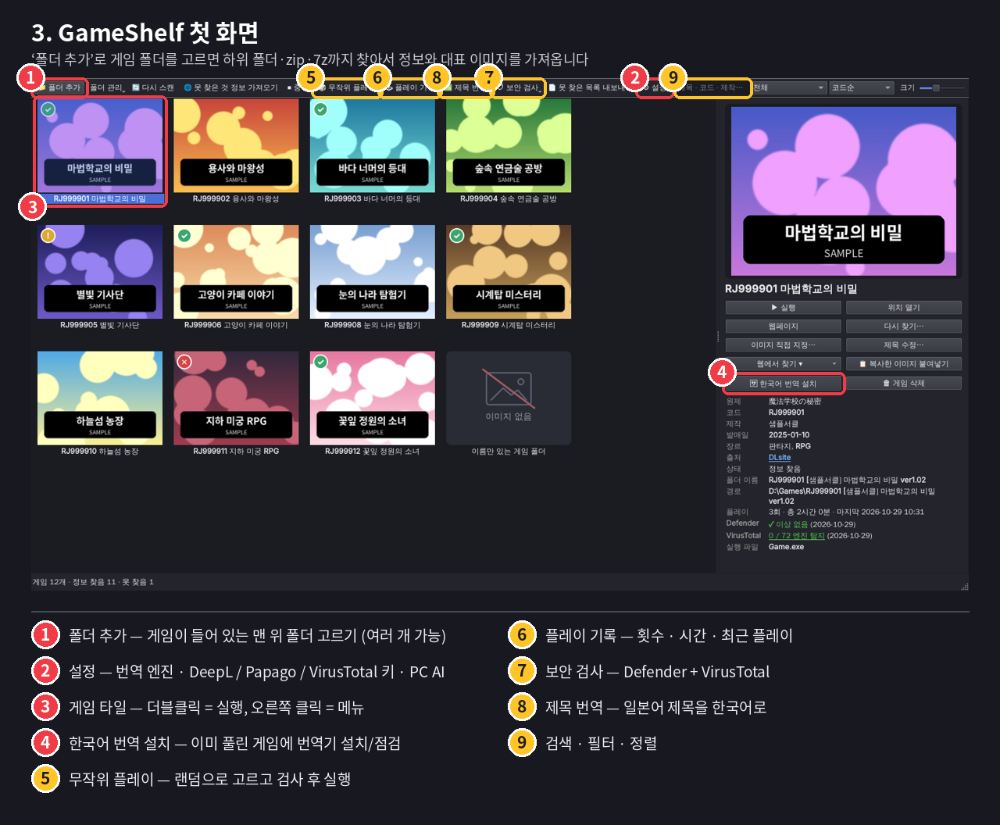
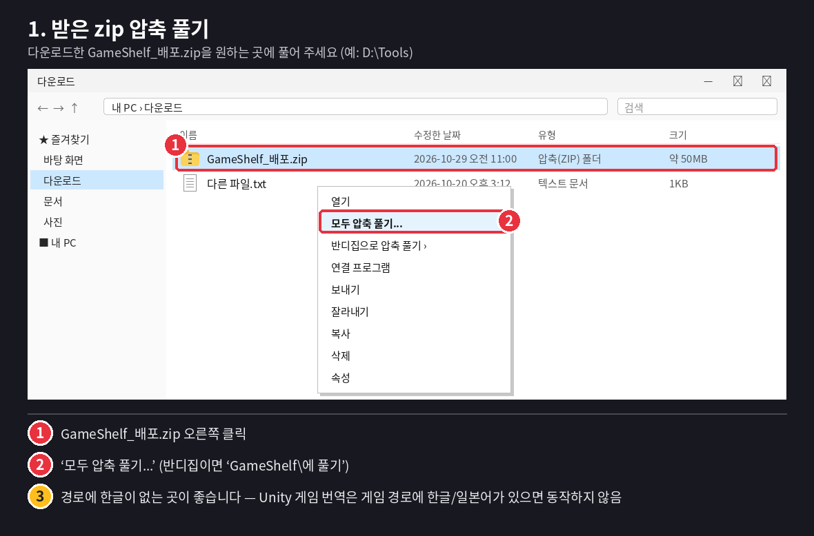
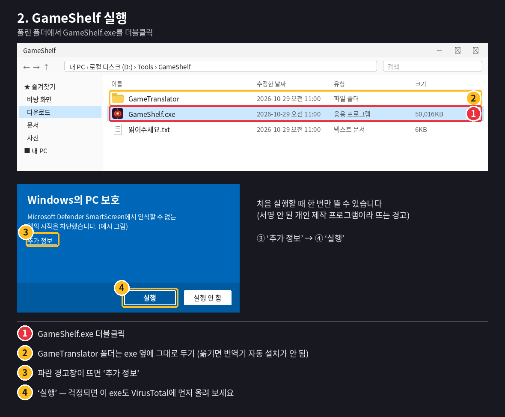
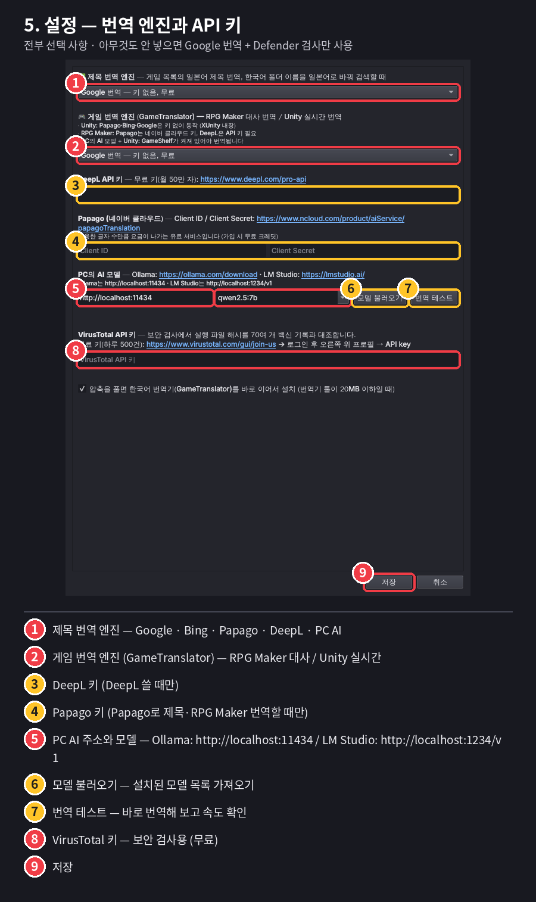
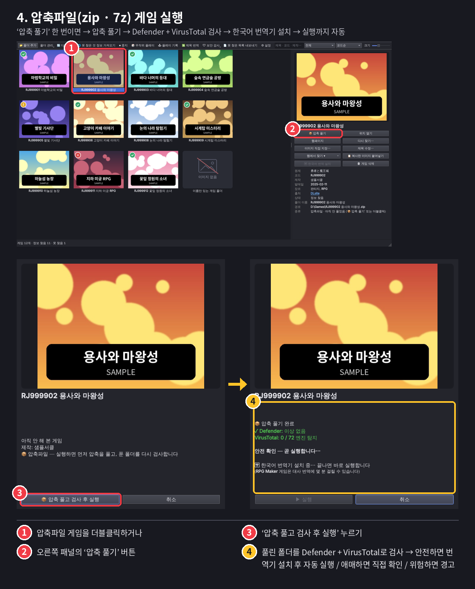
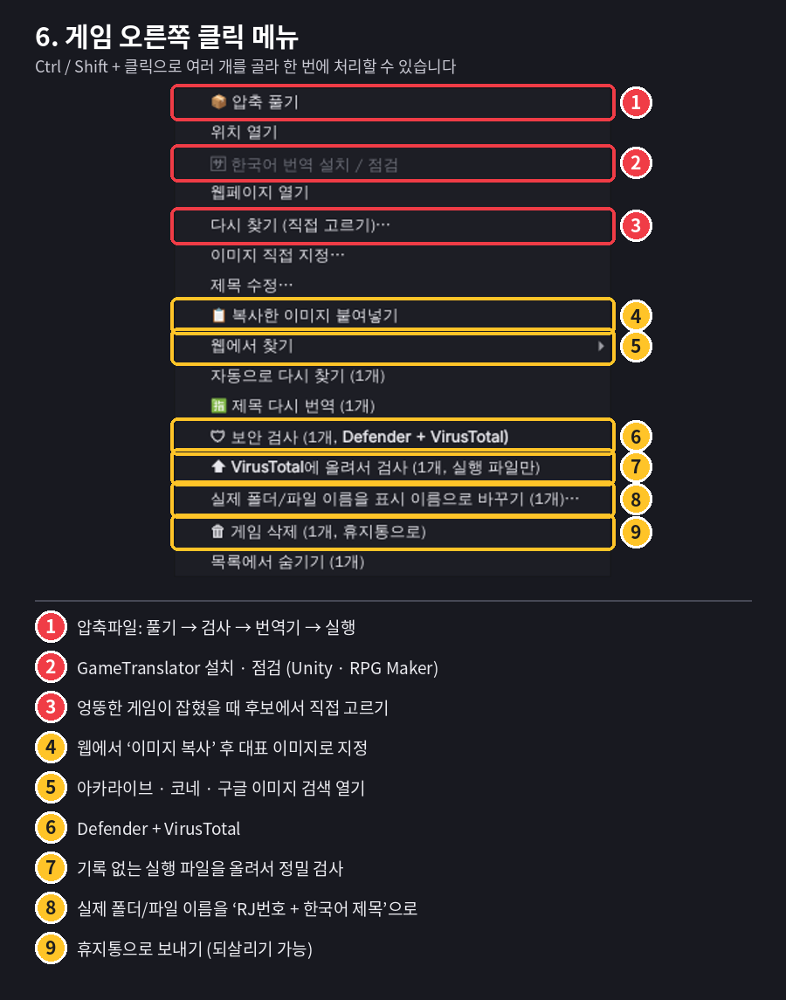
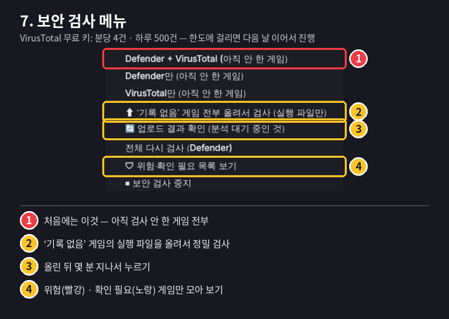

<p align="center">
  
</p>

<h1 align="center">GameShelf</h1>

<p align="center">
  일본 동인게임 라이브러리 + 자동 한국어 번역 + 바이러스 검사 (Windows)
</p>

<p align="center">
  <a href="../../releases/latest"><b>⬇ 최신 버전 다운로드 (GameShelf_배포.zip)</b></a>
</p>

---

폴더에 쌓아 둔 일본 게임(RJ코드 폴더, 이름만 있는 폴더, zip·7z 압축파일)을 한 번에 찾아서
DLsite 등에서 정보와 대표 이미지를 가져와 보여 주는 게임 라이브러리입니다.

## 핵심 기능

**1. 압축만 풀면 한국어 번역기가 자동으로 설치됩니다**
- zip / 7z 게임을 GameShelf에서 **압축 풀기** 하면 풀린 게임에 번역기(GameTranslator)가 이어서 설치됩니다.
- **Unity (Mono)**: BepInEx + XUnity.AutoTranslator 설치 → 원래 exe를 그대로 실행해도 실시간 번역
- **RPG Maker MV / MZ**: 대사·선택지·아이템·스킬·메뉴를 한국어로 번역해서 바꿔 넣음 (원본 자동 백업)

**2. 압축을 풀자마자 Windows Defender + VirusTotal로 검사한 뒤 실행합니다**
- 순서: 압축 풀기 → Defender(풀린 폴더 전체) + VirusTotal(실행 파일) 검사 → 번역기 설치 → 실행
- 안전하면 자동 실행, 애매하면 결과를 보여 주고 직접 선택, 위험하면 경고 (번역기도 설치하지 않음)

**3. 번역 엔진을 고를 수 있고, 내 PC의 AI 모델도 붙일 수 있습니다**
- Google · Bing (키 없이 무료) / Papago · DeepL (키 입력) / 내 PC AI (Ollama · LM Studio)
- 게임 목록의 **제목 번역**과 **게임 번역**을 따로 고를 수 있습니다.

## 설치

> Python 설치는 필요 없습니다. [Releases](../../releases/latest)에서 `GameShelf_배포.zip`만 받으세요.

<details>
<summary><b>1단계 — 받은 zip 압축 풀기</b></summary>

- `GameShelf_배포.zip` 오른쪽 클릭 → **모두 압축 풀기...** (반디집이면 `GameShelf\에 풀기`)
- 가능하면 경로에 한글이 없는 곳에 푸세요. (예: `D:\Tools`)


</details>

<details>
<summary><b>2단계 — GameShelf.exe 실행</b></summary>

- 풀린 폴더의 `GameShelf.exe` 더블클릭
- `GameTranslator` 폴더는 exe 옆에 그대로 두세요. (옮기면 번역기 자동 설치가 안 됩니다)
- 파란 **Windows의 PC 보호** 창이 뜨면 **추가 정보 → 실행** (서명 안 된 개인 제작 프로그램이라 처음 한 번 뜰 수 있습니다)


</details>

<details>
<summary><b>3단계 — 게임 폴더 등록</b></summary>

- 왼쪽 위 **폴더 추가** → 게임이 들어 있는 맨 위 폴더 선택
- 하위 폴더 · zip · 7z까지 찾고, 바로 정보와 대표 이미지를 가져옵니다.
- 여러 드라이브에 나뉘어 있으면 **폴더 추가**를 여러 번 누르면 됩니다.


</details>

<details>
<summary><b>4단계 (선택) — 설정</b></summary>

- 아무것도 안 넣어도 Google 번역 + Defender 검사로 동작합니다.
- VirusTotal 키(무료)를 넣으면 70여 개 백신 엔진 결과까지 같이 봅니다.
- 번역 엔진 · DeepL / Papago 키 · 내 PC AI도 여기서 설정합니다.


</details>

## 사용 방법

<details>
<summary><b>압축파일(zip · 7z) 게임 실행하기</b></summary>

- 게임을 더블클릭하거나 오른쪽 패널의 **압축 풀기** → **압축 풀고 검사 후 실행**
- 압축파일과 같은 위치에 `압축파일 이름` 폴더로 풀립니다. (예: `RJ123456 게임.zip` → `RJ123456 게임\Game.exe`)
- 한 번 풀린 게임은 다음부터 바로 실행됩니다. 풀린 폴더를 지우면 다시 **압축 풀기** 상태로 돌아갑니다.


</details>

<details>
<summary><b>게임 오른쪽 클릭 메뉴</b></summary>

Ctrl / Shift + 클릭으로 여러 개를 골라 한 번에 처리할 수 있습니다.


</details>

<details>
<summary><b>보안 검사</b></summary>

- 처음에는 **보안 검사 → Defender + VirusTotal**을 한 번 돌려 두는 것을 추천합니다.
- 썸네일 왼쪽 위 배지: 🟢 이상 없음 / 🟡 확인 필요(엔진 1~2개 탐지 등) / 🔴 위험


</details>

## 기능 전체 설명

<details>
<summary><b>라이브러리 정리</b></summary>

**폴더 찾기 규칙**
- 고른 폴더와 그 아래 모든 하위 폴더를 찾습니다.
- 이름에 RJ / VJ / BJ / RE 코드가 있는 폴더, 실행 파일(.exe)이 있는 폴더 = 게임 1개
- zip · 7z 압축파일 = 게임 1개 (압축 안을 열어 보지는 않음)
- `unins000.exe`, 크래시 핸들러 같은 부속 exe는 게임으로 치지 않습니다.
- 2,000개 규모에서도 스캔은 몇 초이고, 화면에 보이는 썸네일만 불러와서 가볍게 동작합니다.

**게임 정보 · 대표 이미지 찾기**
- 코드가 있으면 DLsite에서 바로 조회 (제목 · 서클 · 발매일 · 장르 · 대표 이미지)
- 판매 종료 · 예고 작품, AI 카테고리로 옮겨진 작품, 인터넷 보관소(Wayback Machine)에 남은 페이지까지 찾아봅니다.
- 이름만 있으면 `[서클명]` · `ver1.02` · `(DL版)` 같은 부분을 떼고 DLsite → VNDB → Steam 순으로 검색
- 한국어 폴더 이름은 일본어로 번역해서 다시 검색합니다.
- 엉뚱한 게임이 잡히면 **다시 찾기**로 후보 중에서 직접 고르거나 코드를 입력할 수 있습니다.
- 못 찾은 게임은 상세 패널에 **진단**(이유)이 나오고, **못 찾은 목록 내보내기**로 CSV로 뽑을 수 있습니다.

**표시 이름 · 폴더 이름**
- 찾은 게임은 `RJ번호 + 한국어 제목`으로 표시됩니다. (일본어 제목은 번역, 영어 제목은 그대로)
- 원하면 실제 폴더 / 파일 이름도 그 이름으로 바꿀 수 있고, 원래 이름으로 되돌릴 수도 있습니다.
- **제목 수정**으로 직접 지은 이름이 우선이고, 비우면 자동 이름으로 돌아갑니다.

**대표 이미지**
- 이미지를 못 찾은 게임은 모두 같은 "이미지 없음" 그림으로 통일
- **이미지 직접 지정** (내 PC 파일) / **복사한 이미지 붙여넣기** (웹에서 이미지 복사 후)
- **웹에서 찾기** → 아카라이브 · 코네 · 구글 이미지 검색 · DLsite 보관본 바로 열기

**보기 편의**
- 검색(제목 · 코드 · 서클 · 장르), 필터(정보 찾음 · 못 찾음 · 위험 · 플레이한 게임 등), 정렬, 썸네일 크기 조절
- 목록에서 숨기기 / 다시 보이기
</details>

<details>
<summary><b>실행 · 압축 · 기록</b></summary>

**압축 풀기**
- 압축파일과 같은 위치에 같은 이름 폴더로 풀기
- 압축 안이 폴더 한 겹으로 감싸져 있으면 그 껍데기를 벗겨서 바로 아래에 게임 파일이 오게 함
- 같은 이름 폴더가 이미 있으면 "이 폴더를 연결할까요?" 확인
- 암호 걸린 압축이면 암호를 물어봄
- 일본어 파일 이름이 깨지지 않게 반디집 → 7-Zip → 자체 기능 순으로 사용

**무작위 플레이**
- 실행 가능한 게임 중 하나를 골라 줍니다. (안 해 본 게임이 더 잘 뽑히고, 최근 20개는 연달아 나오지 않음)
- 🔴 위험 판정 게임은 후보에서 빠집니다.
- 실행 전에 Defender + VirusTotal 검사를 하고, 압축 게임이면 압축 풀기 → 검사 → 번역기 → 실행

**플레이 기록**
- GameShelf로 켠 게임의 실행 횟수 · 마지막 플레이 · 총 플레이 시간
- 게임별 / 최근 기록 탭, 더블클릭하면 그 게임으로 이동

**게임 삭제**
- 오른쪽 클릭 / 상세 패널 / Delete 키 → 휴지통으로 (되살리기 가능)
- 압축파일 게임이면 풀린 폴더도 같이 휴지통으로
- 등록한 맨 위 폴더(예: `D:\Games`) 자체는 지워지지 않게 막혀 있습니다.
</details>

<details>
<summary><b>보안 검사</b></summary>

**Windows Defender**
- 게임 폴더(압축 게임은 풀린 폴더, 안 풀었으면 압축파일)를 검사합니다.
- 위협을 찾아도 지우거나 격리하지 않고 결과만 기록합니다. (오탐으로 게임이 망가지는 것 방지)

**VirusTotal 조회** (무료 키 필요)
- 실행 파일의 해시값만 보내서 70여 개 엔진의 기존 검사 기록을 봅니다. 파일은 올리지 않습니다.
- 안 푼 압축 게임은 압축 안의 메인 exe만 잠깐 꺼내서 해시를 계산합니다. (게임은 풀지 않음)
- 무료 한도(분당 4건 · 하루 500건)에 맞춰 자동으로 천천히, 한도가 차면 다음 날 이어서

**VirusTotal에 올려서 정밀 검사** (직접 눌러야만 실행)
- "기록 없음"이 나온 게임의 실행 파일(.exe · .dll 등)만 골라서 올립니다. 그림 · 음성은 올리지 않습니다.
- 650MB가 넘는 파일은 올릴 수 없어 Defender 결과로 판단합니다.

**실행 전 검사 · 배지**
- 실행할 때(무작위 · 압축 게임) 다시 한 번 검사하고 결과에 따라 자동 실행 / 확인 / 경고
- 🟢 이상 없음 · 🟡 확인 필요 · 🔴 위험 (Defender 위협 또는 3개 이상 엔진 탐지)
</details>

<details>
<summary><b>번역</b></summary>

**제목 번역**
- 일본어 제목을 한국어로 번역해서 표시 (원제는 상세 패널에 남음)
- 여러 제목을 묶어서 천천히 보내기 때문에 2,000개도 몇 분이면 끝납니다.

**게임 번역 (GameTranslator)**
- **Unity (Mono)**: BepInEx 5.4.22 + XUnity.AutoTranslator 5.6.3 설치 → 게임 안에서 `Alt+T`로 원문/번역 전환
- **RPG Maker MV / MZ**: 데이터 파일을 번역해서 바꿔 넣음. 원본은 `data_GTbackup`에 백업하고,
  번역문은 `GameTranslator_RPG\translations.tsv`에 저장 (메모장으로 고친 뒤 **다시 적용**하면 반영)
- 그 밖의 엔진(쯔꾸르 XP/VX, WOLF, 吉里吉里, Ren'Py 등)은 엔진 이름과 맞는 도구를 안내만 합니다.
- 게임 폴더를 오른쪽 클릭해서 GameTranslator만 따로 쓸 수도 있습니다. (`GameTranslator\Setup.bat` 한 번 실행)

**번역 엔진**

| 엔진 | 키 | 비고 |
|---|---|---|
| Google | 없음 | 무료 |
| Bing | 없음 | 무료 |
| Papago | Unity는 없음 / 제목 · RPG Maker는 네이버 클라우드 키 | 키 사용 시 유료 |
| DeepL | API 키 | 무료 월 50만 자 |
| 내 PC AI | 없음 | Ollama · LM Studio, 인터넷 · 횟수 제한 없음 |
</details>

## 번역 AI 추가하는 법

<details open>
<summary><b>키만 넣으면 되는 것 — DeepL · Papago</b></summary>

- **DeepL**: <https://www.deepl.com/pro-api> → 무료 가입 → API 키 복사 → 설정의 DeepL 칸
- **Papago**: <https://www.ncloud.com/product/aiService/papagoTranslation> → Client ID / Secret → 설정
- 넣은 뒤 **제목 번역 엔진** 또는 **게임 번역 엔진**에서 그 엔진을 고르고 저장
</details>

<details open>
<summary><b>내 PC의 AI 모델 붙이기 — Ollama · LM Studio</b></summary>

1. <https://ollama.com/download>에서 설치
2. 명령 프롬프트에서 모델 받기 — 예: `ollama pull qwen2.5:7b`
   (그래픽카드 메모리가 적으면 더 작은 모델, 많으면 더 큰 모델)
3. 설정 → **PC의 AI 모델** 주소에 `http://localhost:11434`
4. **모델 불러오기** → 받은 모델 고르기 → **번역 테스트**로 확인
5. **제목 번역 엔진** / **게임 번역 엔진**에서 **PC의 AI 모델** 선택 → 저장

LM Studio(<https://lmstudio.ai/>)는 모델을 받고 Local Server를 켠 뒤 주소에 `http://localhost:1234/v1`을 넣으면 됩니다.

- Unity 게임을 PC AI로 번역할 때는 **GameShelf를 켜 둔 상태에서** 게임을 실행해야 합니다. (GameShelf가 게임과 AI 사이를 이어 줍니다)
- 엔진을 바꾸면 "이미 번역기가 설치된 Unity 게임에도 적용할까요?"라고 물어봅니다.
- RPG Maker는 이미 번역된 문장은 그대로 두고 새 문장만 새 엔진으로 번역합니다.
  전부 다시 하려면 게임 폴더의 `GameTranslator_RPG\translations.tsv`를 지운 뒤 **다시 적용**.
</details>

## ⚠ 주의사항

- **테스트 범위**
  - 아카라이브 · 코네에서 이미지 찾기(웹에서 찾기 → 이미지 복사 → 붙여넣기)는 직접 테스트해 보지 못했습니다.
  - 게임 번역은 직접 돌려 본 게 Unity 게임 1개, RPG Maker 게임 1개뿐입니다. 같은 엔진이라도 버전이나 게임마다 구조가 달라서 다른 게임에서는 안 될 수 있습니다.
- 바이러스 검사는 **참고용**입니다. Defender와 VirusTotal에 안 걸려도 100% 안전하다는 뜻은 아닙니다. 반대로 번역 패치 · 실행 도구(BepInEx 등)는 백신이 잘못 잡는 경우(오탐)도 많습니다.
- **VirusTotal에 올려서 검사**로 올린 파일은 VirusTotal과 보안 회사들이 볼 수 있습니다. 게임 폴더에 개인 파일이 섞여 있지 않은지 확인하세요. (해시 조회는 파일을 올리지 않습니다)
- 번역할 때 게임 제목 · 대사가 고른 번역 서비스(Google · Bing · Papago · DeepL)로 전송됩니다. 외부로 보내기 싫으면 내 PC의 AI 모델을 쓰세요.
- Unity 게임 번역은 게임 경로에 한글 · 일본어 폴더 이름이 있으면 동작하지 않습니다. (BepInEx 제한)
- 7z 압축 게임을 풀려면 반디집 또는 7-Zip이 PC에 설치되어 있어야 합니다.
- 사용하면서 생기는 `GameShelf_data` 폴더는 절대 공유하지 마세요. 게임 목록과 API 키가 들어 있습니다.
- 이 프로그램에는 게임 파일이 들어 있지 않습니다. 게임은 직접 구매 · 보유한 것을 쓰세요.
- Windows 전용입니다. 문제가 생기면 상세 패널의 **진단** / 오류 문구와 함께 [Issues](../../issues)에 남겨 주세요.

## 소스에서 실행 · 빌드

```bat
:: Python 3.10 이상 (https://www.python.org/downloads/ — 설치할 때 "Add python.exe to PATH" 체크)
실행.bat                 :: 바로 실행 (처음에 PySide6, requests 자동 설치)
exe로_만들기.bat         :: dist\GameShelf.exe 만들기
배포용_zip_만들기.bat    :: exe + GameTranslator + 안내문만 담은 GameShelf_배포.zip 만들기 (개인 파일 자동 제외)
```

`v1.0.0` 같은 태그를 올리면 GitHub Actions(`.github/workflows/release.yml`)가 Windows에서 exe를 만들어 Releases에 `GameShelf_배포.zip`을 자동으로 올립니다.

## 라이선스

- GameShelf: [MIT](LICENSE)
- 포함된 외부 프로그램 (`GameTranslator/payload`)
  - [BepInEx 5.4.22](https://github.com/BepInEx/BepInEx/tree/v5-lts) — MIT ([원문](licenses/BepInEx-5-LICENSE.txt))
  - [XUnity.AutoTranslator 5.6.3](https://github.com/bbepis/XUnity.AutoTranslator) — MIT ([원문](licenses/XUnity.AutoTranslator-LICENSE.txt))
- Windows 빌드(`GameShelf.exe`)에는 [PySide6 / Qt](https://www.qt.io/qt-for-python)(LGPL-3.0)가 함께 묶여 있습니다.
